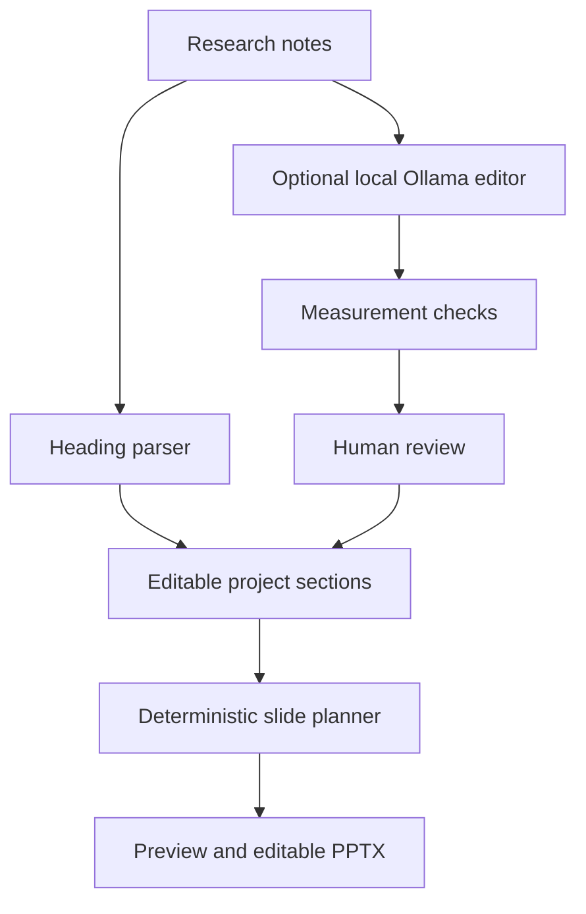

# Weekly Research Update Generator — V2.6.1

A local-first Streamlit application that turns research notes into structured, editable PowerPoint presentations. Developed to reduce repetitive scientific reporting while keeping researchers in control of experimental evidence and interpretation.

**Project status:** actively developed. The source code is public; research notes, experimental datasets, local drafts, and reference presentations should remain local and confidential.

## Highlights

- Multi-project management and bilingual heading-based note organization.
- Editable PowerPoint export with deterministic slide planning and preview.
- Optional local Ollama integration for scientific language editing.
- Measurement consistency warnings and human approval before applying AI proposals.
- Local draft persistence; no remote AI fallback in the documented workflow.

## Architecture



## Synthetic example

Paste the following fictional notes into a new project to explore the heading parser without exposing research data:

```text
Objectives: Compare two fictional samples.
Results: Sample A measured 12 mm; sample B measured 15 mm.
Next Steps: Repeat the measurements under the same conditions.
```

Review the organized sections before exporting. These numbers are illustrative, not experimental results.

## Install & run (Windows PowerShell)

Clone `https://github.com/herminenee/Weekly-Update-Generator.git` first. Local Ollama and the `qwen2.5:3b` model are needed only for optional AI editing.
```powershell
cd Weekly-Update-Generator
py -m venv .venv
.venv\Scripts\Activate.ps1
pip install -r requirements.txt
streamlit run app.py
```

Ubuntu:
```bash
cd Weekly-Update-Generator
python3 -m venv .venv
source .venv/bin/activate
pip install -r requirements.txt
streamlit run app.py
```

## How to use
1. Add, rename, reorder, and delete projects in the sidebar. Deletion requires confirmation.
2. Select a project and paste notes with English or common Chinese headings such as `Objectives:`, `目标:`, `Experimental Work:`, `实验:`, `Results:`, `结果:`, `Discussion:`, `讨论:`, `Challenges:`, `问题:`, `Next Steps:`, or `下一步:`.
3. Click **Organize notes into sections** for the selected project.
4. Review every project section; empty sections are collapsed and all content remains editable.
5. Optionally upload a previous PPTX to inherit its basic theme and slide size.
6. Use **Save draft** and **Load draft** to persist local JSON drafts in `.local_drafts` (or another local folder).
7. Optionally run **Faithful Scientific Editing**. It sends the supplied notes only to the local Ollama endpoint at `127.0.0.1:11434` using `qwen2.5:3b`.
8. Review the original notes, proposed sections, and any measurement warnings. Proposals never replace project sections automatically.
9. Choose **Concise** or **Detailed** slide composition.
10. Choose **Reference Style** or **Safe Default Style**. Reference Style is selected by default only when the local `templates/Weekly_Update_20261005.pptx` exists.
11. Choose whether to include project divider slides. Dividers are omitted by default in Concise mode.
12. Review the slide-plan preview.
13. Click **Generate editable PowerPoint** and download; insert your own figures manually.

## Tests

The repository includes tests for scientific editing, draft loading, scientific writing, and slide composition in `tests/`. Inspect the test files for their requirements and run them in your development environment before relying on changes. Test execution is not claimed by this documentation update.

## Limitations
- Conservative heading parser, **not AI-based**; does not rewrite or translate scientific prose.
- Reference Style uses only verified metadata from the local reference deck: Times New Roman titles, Bitstream Charter headings/body/footer, dark-blue/red/gray colors, and reference-based margins. It does not copy reference slide text or experiment content.
- Safe Default Style remains available when the reference style is not desired. If the local reference deck is absent, Safe Default Style is selected automatically.
- An uploaded PPTX supplies **theme / slide size**, not exact custom layouts or pixel-perfect formatting.
- Slides are grouped by project and auto-formatted in an intentionally simple layout, with room for manually inserted images.
- Draft saves use new timestamped filenames and do not overwrite existing JSON drafts.
- Faithful Scientific Editing is an unverified draft aid; it does not guarantee scientific accuracy.
- No remote AI calls, cloud fallback, automatic scientific claims, or automatic section overwrites.
- The local editor checks numeric values and units for missing or altered measurements and requires human review when warnings are present.
- Scientific validation normalizes common forms such as `25°C` and `25 °C`, distinguishes missing, altered, added, and duplicate-count differences, and reports source sections that contain substantive text while the proposal is empty. These checks are deterministic warnings, not a guarantee of scientific correctness.
- Ollama responses are requested with a strict JSON schema and rejected if invalid, incomplete, truncated, or typed incorrectly.
- Concise mode combines short related sections and avoids unnecessary project divider slides; Detailed mode uses smaller content groups and may create more slides.
- The deterministic slide planner preserves approved text and checks for omitted or duplicated content before export.
- The slide-plan preview is the same plan used for export.
- V2.4 uses bounded single-column text regions for long content, project-only primary titles, and `Part N` titles when a project spans multiple slides.
- Text-height decisions use conservative character-based estimates; PowerPoint font metrics and wrapping can still vary by installed fonts and template dimensions.
- Lower slide space is intentionally left open for manually inserted experimental photos; no image placeholders or photos are generated.
- Project divider slides are optional. When enabled, they are added only for projects spanning multiple content slides.
- Reference typography is larger than the safe default, so the deterministic planner uses a more conservative per-slide content budget and creates additional slides when needed. PowerPoint's final font metrics can still vary by installed fonts.
- Genuinely short project content may use a checked two-column layout in Concise mode; long paragraphs remain single-column. The layout decision is deterministic and does not change or omit approved text.
- Concise pagination evaluates combined section height against the actual Reference Style column capacity before splitting. A short five-section project can therefore fit on one compact content slide when both columns are safe; larger projects remain paginated.
- Uploaded PPTX files preserve their slide dimensions and theme source; generated content still uses the application's safe text layout rather than claiming exact template fidelity.
- Local drafts and common experimental-data files are excluded by `.gitignore`.
- An uploaded PPTX supplies theme and slide dimensions, not exact custom layouts or pixel-perfect formatting.
